# Retro Icons — Page 4 of 8

[Index](README.md) · [Page 1](page1.md) · [Page 2](page2.md) · [Page 3](page3.md) · [Page 4](page4.md) · [Page 5](page5.md) · [Page 6](page6.md) · [Page 7](page7.md) · [Page 8](page8.md)

  <a href="ICO/FLOPPY-DISKS-113.ICO?raw=1" title="FLOPPY-DISKS-113">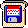</a> <a href="ICO/FLOPPY-DISKS-114.ICO?raw=1" title="FLOPPY-DISKS-114">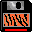</a>     <a href="ICO/FLOPPY-DISKS-119.ICO?raw=1" title="FLOPPY-DISKS-119">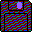</a> <a href="ICO/FLOPPY-DISKS-120.ICO?raw=1" title="FLOPPY-DISKS-120">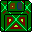</a> <a href="ICO/FLOPPY-DISKS-121.ICO?raw=1" title="FLOPPY-DISKS-121">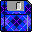</a> <a href="ICO/FLOPPY-DISKS-122.ICO?raw=1" title="FLOPPY-DISKS-122">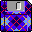</a> <a href="ICO/FLOPPY-DISKS-123.ICO?raw=1" title="FLOPPY-DISKS-123">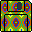</a>            
                        
                        
                        
                        
                        
<a href="ICO/HARDWARE-010.ICO?raw=1" title="HARDWARE-010">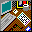</a>                        
  <a href="ICO/HARDWARE-038.ICO?raw=1" title="HARDWARE-038">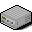</a>            <a href="ICO/HARDWARE-050.ICO?raw=1" title="HARDWARE-050">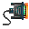</a>          
    <a href="ICO/HARDWARE-065.ICO?raw=1" title="HARDWARE-065">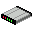</a>              <a href="ICO/HARDWARE-079.ICO?raw=1" title="HARDWARE-079">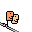</a>  <a href="ICO/HARDWARE-081.ICO?raw=1" title="HARDWARE-081">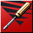</a>   <a href="ICO/HARDWARE-084.ICO?raw=1" title="HARDWARE-084">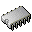</a> 
        <a href="ICO/HARDWARE-094.ICO?raw=1" title="HARDWARE-094">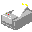</a>            <a href="ICO/HARDWARE-106.ICO?raw=1" title="HARDWARE-106">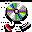</a>    
     <a href="ICO/HARDWARE-116.ICO?raw=1" title="HARDWARE-116">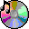</a>   <a href="ICO/HARDWARE-119.ICO?raw=1" title="HARDWARE-119">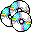</a>   <a href="ICO/HARDWARE-122.ICO?raw=1" title="HARDWARE-122">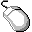</a>  <a href="ICO/HARDWARE-124.ICO?raw=1" title="HARDWARE-124">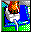</a>    <a href="ICO/HARDWARE-128.ICO?raw=1" title="HARDWARE-128">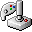</a>      <a href="ICO/HARDWARE-134.ICO?raw=1" title="HARDWARE-134">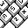</a> 
   <a href="ICO/HARDWARE-139.ICO?raw=1" title="HARDWARE-139">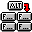</a> <a href="ICO/HARDWARE-140.ICO?raw=1" title="HARDWARE-140">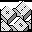</a>                    
   <a href="ICO/HDDS-003.ICO?raw=1" title="HDDS-003">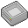</a> <a href="ICO/HDDS-004.ICO?raw=1" title="HDDS-004">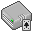</a>   <a href="ICO/HDDS-007.ICO?raw=1" title="HDDS-007">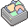</a> <a href="ICO/HDDS-008.ICO?raw=1" title="HDDS-008">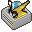</a> <a href="ICO/HDDS-009.ICO?raw=1" title="HDDS-009">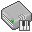</a> <a href="ICO/HDDS-010.ICO?raw=1" title="HDDS-010">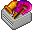</a> <a href="ICO/HDDS-011.ICO?raw=1" title="HDDS-011">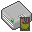</a> <a href="ICO/HDDS-012.ICO?raw=1" title="HDDS-012">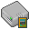</a> <a href="ICO/HDDS-013.ICO?raw=1" title="HDDS-013">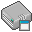</a> <a href="ICO/HDDS-014.ICO?raw=1" title="HDDS-014">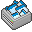</a> <a href="ICO/HDDS-015.ICO?raw=1" title="HDDS-015">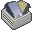</a> <a href="ICO/HDDS-016.ICO?raw=1" title="HDDS-016">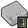</a>        
     <a href="ICO/HOLIDAYS-001.ICO?raw=1" title="HOLIDAYS-001">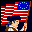</a>   <a href="ICO/HOLIDAYS-004.ICO?raw=1" title="HOLIDAYS-004">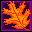</a> <a href="ICO/HOLIDAYS-005.ICO?raw=1" title="HOLIDAYS-005">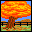</a>               <a href="ICO/HOUSEHOLD-ITEMS-002.ICO?raw=1" title="HOUSEHOLD-ITEMS-002">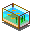</a>
        <a href="ICO/HOUSEHOLD-ITEMS-011.ICO?raw=1" title="HOUSEHOLD-ITEMS-011">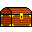</a>   <a href="ICO/HOUSEHOLD-ITEMS-014.ICO?raw=1" title="HOUSEHOLD-ITEMS-014">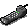</a>  <a href="ICO/HOUSEHOLD-ITEMS-016.ICO?raw=1" title="HOUSEHOLD-ITEMS-016">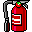</a>    <a href="ICO/HOUSEHOLD-ITEMS-020.ICO?raw=1" title="HOUSEHOLD-ITEMS-020">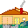</a>  <a href="ICO/HOUSEHOLD-ITEMS-022.ICO?raw=1" title="HOUSEHOLD-ITEMS-022">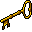</a>   <a href="ICO/HOUSEHOLD-ITEMS-025.ICO?raw=1" title="HOUSEHOLD-ITEMS-025">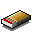</a> <a href="ICO/HOUSEHOLD-ITEMS-026.ICO?raw=1" title="HOUSEHOLD-ITEMS-026">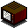</a> 
    <a href="ICO/HOUSEHOLD-ITEMS-032.ICO?raw=1" title="HOUSEHOLD-ITEMS-032">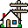</a>       <a href="ICO/HOUSEHOLD-ITEMS-039.ICO?raw=1" title="HOUSEHOLD-ITEMS-039">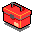</a>             
           <a href="ICO/ICON-HEAR-IT-002.ICO?raw=1" title="ICON-HEAR-IT-002">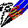</a>             
                        
                        
                        

[Index](README.md) · [Page 1](page1.md) · [Page 2](page2.md) · [Page 3](page3.md) · [Page 4](page4.md) · [Page 5](page5.md) · [Page 6](page6.md) · [Page 7](page7.md) · [Page 8](page8.md)
