# Retro Icons — Page 7

[Page 1](page1.md) · [Page 2](page2.md) · [Page 3](page3.md) · [Page 4](page4.md) · [Page 5](page5.md) · [Page 6](page6.md) · [Page 7](page7.md) · [Page 8](page8.md) · [Index](README.md)

<a href="ICO/PLACES-035.ICO?raw=1">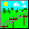</a>

<a href="ICO/PLACES-037.ICO?raw=1">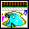</a>
<a href="ICO/PLACES-038.ICO?raw=1">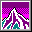</a>
<a href="ICO/PLACES-039.ICO?raw=1">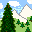</a>
<a href="ICO/PLACES-040.ICO?raw=1">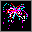</a>
<a href="ICO/PLACES-041.ICO?raw=1">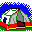</a>

<a href="ICO/SCIENCE-001.ICO?raw=1">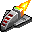</a>

<a href="ICO/SCIENCE-003.ICO?raw=1">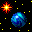</a>

<a href="ICO/SCIENCE-006.ICO?raw=1">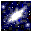</a>
<a href="ICO/SCIENCE-007.ICO?raw=1">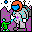</a>

<a href="ICO/SCIENCE-009.ICO?raw=1">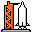</a>

<a href="ICO/SCIENCE-015.ICO?raw=1">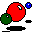</a>

<a href="ICO/SCIENCE-018.ICO?raw=1">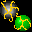</a>

<a href="ICO/SCIENCE-021.ICO?raw=1">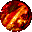</a>

<a href="ICO/SCIENCE-023.ICO?raw=1">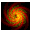</a>

<a href="ICO/SHAPES-AND-SIGNS-001.ICO?raw=1">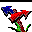</a>

<a href="ICO/SHAPES-AND-SIGNS-003.ICO?raw=1">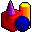</a>
<a href="ICO/SHAPES-AND-SIGNS-004.ICO?raw=1">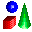</a>

<a href="ICO/SHAPES-AND-SIGNS-006.ICO?raw=1">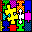</a>
<a href="ICO/SHAPES-AND-SIGNS-007.ICO?raw=1">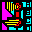</a>
<a href="ICO/SHAPES-AND-SIGNS-008.ICO?raw=1">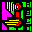</a>
<a href="ICO/SHAPES-AND-SIGNS-009.ICO?raw=1">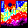</a>
<a href="ICO/SHAPES-AND-SIGNS-010.ICO?raw=1">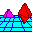</a>
<a href="ICO/SHAPES-AND-SIGNS-011.ICO?raw=1">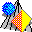</a>

<a href="ICO/SHAPES-AND-SIGNS-015.ICO?raw=1">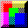</a>

<a href="ICO/SHAPES-AND-SIGNS-018.ICO?raw=1">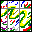</a>

<a href="ICO/SHAPES-AND-SIGNS-020.ICO?raw=1">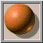</a>

<a href="ICO/SHAPES-AND-SIGNS-022.ICO?raw=1">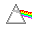</a>
<a href="ICO/SHAPES-AND-SIGNS-023.ICO?raw=1">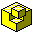</a>

<a href="ICO/SHAPES-AND-SIGNS-025.ICO?raw=1">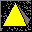</a>

<a href="ICO/SHAPES-AND-SIGNS-027.ICO?raw=1">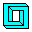</a>
<a href="ICO/SHAPES-AND-SIGNS-028.ICO?raw=1">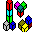</a>
<a href="ICO/SHAPES-AND-SIGNS-029.ICO?raw=1">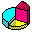</a>

<a href="ICO/SHAPES-AND-SIGNS-032.ICO?raw=1">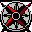</a>
<a href="ICO/SHAPES-AND-SIGNS-033.ICO?raw=1">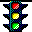</a>
<a href="ICO/SHAPES-AND-SIGNS-034.ICO?raw=1">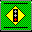</a>

<a href="ICO/SHAPES-AND-SIGNS-050.ICO?raw=1">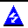</a>

<a href="ICO/SHAPES-AND-SIGNS-058.ICO?raw=1">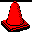</a>
<a href="ICO/SHAPES-AND-SIGNS-059.ICO?raw=1">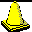</a>

<a href="ICO/SPACE-ICONS-002.ICO?raw=1">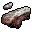</a>
<a href="ICO/SPACE-ICONS-003.ICO?raw=1">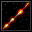</a>
<a href="ICO/SPACE-ICONS-004.ICO?raw=1">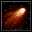</a>
<a href="ICO/SPACE-ICONS-005.ICO?raw=1">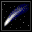</a>

<a href="ICO/SPACE-ICONS-008.ICO?raw=1">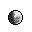</a>
<a href="ICO/SPACE-ICONS-009.ICO?raw=1">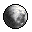</a>
<a href="ICO/SPACE-ICONS-010.ICO?raw=1">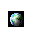</a>

<a href="ICO/SPACE-ICONS-012.ICO?raw=1">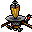</a>
<a href="ICO/SPACE-ICONS-013.ICO?raw=1">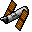</a>
<a href="ICO/SPACE-ICONS-014.ICO?raw=1">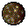</a>
<a href="ICO/SPACE-ICONS-015.ICO?raw=1">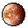</a>

[Page 1](page1.md) · [Page 2](page2.md) · [Page 3](page3.md) · [Page 4](page4.md) · [Page 5](page5.md) · [Page 6](page6.md) · [Page 7](page7.md) · [Page 8](page8.md) · [Index](README.md)
