# Retro Icons — Page 8

[Page 1](page1.md) · [Page 2](page2.md) · [Page 3](page3.md) · [Page 4](page4.md) · [Page 5](page5.md) · [Page 6](page6.md) · [Page 7](page7.md) · [Page 8](page8.md) · [Index](README.md)

<a href="ICO/THE-NET-006.ICO?raw=1">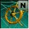</a>

<a href="ICO/THE-NET-011.ICO?raw=1">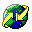</a>

<a href="ICO/THE-NET-013.ICO?raw=1">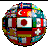</a>

<a href="ICO/THE-NET-015.ICO?raw=1">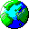</a>

<a href="ICO/THE-NET-021.ICO?raw=1">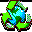</a>

<a href="ICO/THE-NET-023.ICO?raw=1">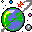</a>

<a href="ICO/THE-NET-026.ICO?raw=1">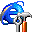</a>
<a href="ICO/THE-NET-027.ICO?raw=1">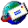</a>

<a href="ICO/THE-NET-029.ICO?raw=1">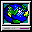</a>
<a href="ICO/THE-NET-030.ICO?raw=1">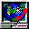</a>

<a href="ICO/THE-NET-032.ICO?raw=1">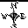</a>
<a href="ICO/THE-NET-033.ICO?raw=1">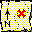</a>
<a href="ICO/THE-NET-034.ICO?raw=1">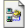</a>

<a href="ICO/THE-NET-043.ICO?raw=1">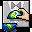</a>

[Page 1](page1.md) · [Page 2](page2.md) · [Page 3](page3.md) · [Page 4](page4.md) · [Page 5](page5.md) · [Page 6](page6.md) · [Page 7](page7.md) · [Page 8](page8.md) · [Index](README.md)
